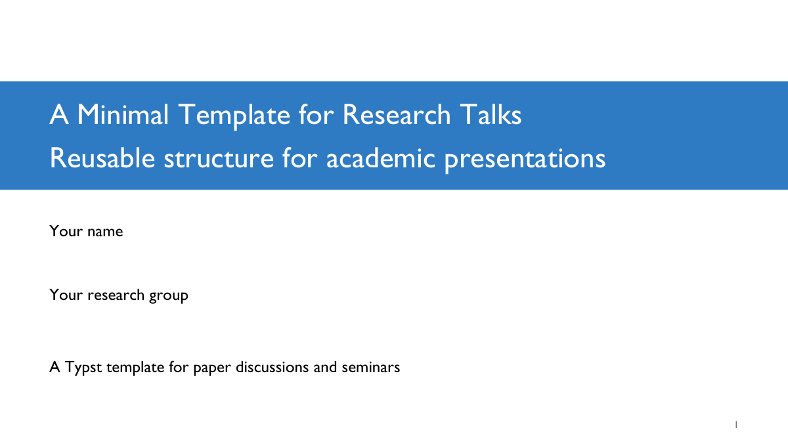
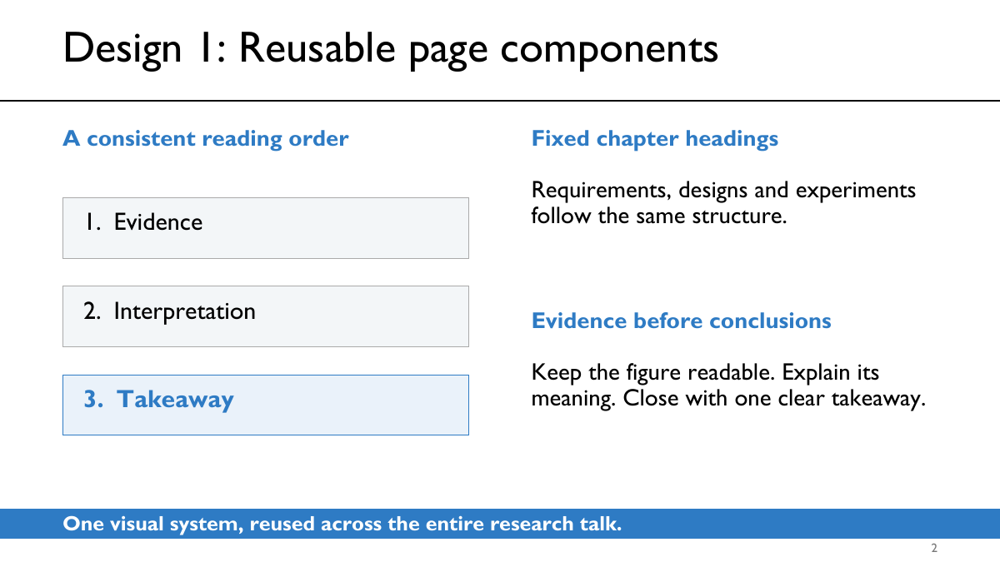

# Academic Template

一个简洁的 Typst 学术报告模板：Gill Sans MT、白底蓝色强调，以及固定的 Requirement / Design / Experimental setup 章节结构。




## 快速开始

下载仓库后，在仓库目录运行：

```sh
python3 new-talk.py ../my-talk --title "Your research title" --system "Your System"
cd ../my-talk
python3 build.py
```

编辑 `main.typ`，输出位于 `build/main.pdf`。持续预览使用 `python3 build.py --watch`。

需要 **Typst ≥ 0.11.1、Python ≥ 3.9、Gill Sans MT**。字体不随仓库分发；macOS 自动查找已安装 Office 的字体，其他环境可传 `--font-path /path/to/fonts`。

完整的制作规范与接口说明见 [AGENT.md](AGENT.md)。仓库内运行 `python3 build.py` 可预览 14 页通用起稿。

[MIT License](LICENSE)
